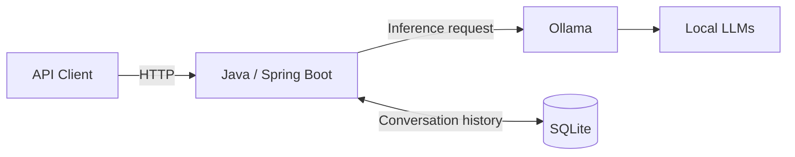

<div align="center">

# Local LLM Inference & Model Serving Platform

**A Java-based application for serving locally hosted language models through REST APIs, with persistent conversation management.**


</div>

---

## Overview

This independent engineering project explores how to turn **local large language model (LLM) inference** into an API-accessible application and, incrementally, into a more reliable model-serving platform.

The application uses **Java 25 and Spring Boot** for the backend, **Ollama** to run open-weight language models locally, and **SQLite** to persist conversations. Development follows small, working increments: implement a feature, test and debug it, then address the next practical engineering concern.

**Current scope:** A locally running application, not a publicly deployed or production-hardened service.

## What it does

- Exposes model interaction through a Spring Boot HTTP API.
- Integrates with locally hosted LLMs using Ollama.
- Maintains conversation history using SQLite persistence.
- Uses SQL migrations to evolve the database schema.
- Provides a foundation for exploring model-serving reliability, security, observability and deployment.

## High-level architecture



An API client submits a request to Spring Boot. The application invokes the selected local model through Ollama, manages conversation state, stores conversation data in SQLite and returns the response.

> The diagram shows logical components rather than infrastructure or deployment topology.

## Local models

Inference runs **locally through Ollama**, rather than through a hosted LLM API. The development environment includes six models covering general-purpose, reasoning-oriented and coding-oriented use cases.

| Model | Ollama identifier | Local download size |
| --- | --- | ---: |
| DeepSeek-R1 (7B) | `deepseek-r1:7b` | 4.7 GB |
| Gemma 3 (4B) | `gemma3:4b` | 3.3 GB |
| Phi-4 Mini (3.8B) | `phi4-mini:3.8b` | 2.5 GB |
| Qwen 3 (4B) | `qwen3:4b` | 2.5 GB |
| Llama 3.2 (3B) | `llama3.2:3b` | 2.0 GB |
| Qwen 2.5 Coder (7B) | `qwen2.5-coder:7b` | 4.7 GB |

These identifiers and sizes reflect the models **installed in the local Ollama environment**. Availability does not imply that all six have undergone formal evaluation or performance benchmarking.

To inspect the models available on your own machine:

```bash
ollama list
```

**Ollama is the inference runtime; the models are independently downloaded model weights.** The application uses the configured model identifier when making inference requests.

## Technology stack

| Layer | Technology |
| --- | --- |
| Application language | Java 25 |
| Backend and API | Spring Boot, REST/HTTP |
| Local model inference | Ollama and open-weight LLMs |
| Conversation persistence | SQLite, SQL migrations |
| Build | Maven Wrapper |
| Development environment | IntelliJ IDEA |

## Run locally

### Prerequisites

- **JDK 25**
- **Ollama**, installed and running
- At least one local model available in Ollama
- Git and a terminal (or IntelliJ IDEA)

### 1. Check Ollama

```bash
ollama list
```

If the model configured in the application is not installed, download it using its actual model identifier:

```bash
ollama pull qwen3:4b
```

`qwen3:4b` is an example from the local model inventory; use the identifier configured in your application.

Ollama's default local API address is `http://localhost:11434`.

### 2. Configure the backend

Review the application configuration in `src/main/resources` and confirm that the **Ollama endpoint**, **model identifier** and **SQLite database location** match your local setup.

SQLite stores data in a local database file; it does not require a separate database server.

### 3. Run the application

**Windows:**

```powershell
.\mvnw.cmd spring-boot:run
```

**macOS / Linux:**

```bash
./mvnw spring-boot:run
```

Alternatively, import `pom.xml` into IntelliJ IDEA and run the Spring Boot main class.

### 4. Explore the API

Inspect the controller mappings in `src/main/java` for the current endpoints and request formats. The API contract may change as the project evolves.

## Engineering direction

| Area | Status |
| --- | --- |
| Spring Boot backend and local LLM integration | Implemented locally |
| Conversation persistence with SQLite | Implemented locally |
| API validation and failure handling | Incremental improvement |
| Authentication and access control | Planned |
| Logging, metrics and tracing | Planned |
| Containerized deployment and external access | Planned |
| Reliability, scaling and database evolution | Planned |

These are **development goals, not claims of completed production capabilities**.

## Design approach

The project prioritizes **clear code, inspectable execution paths and practical architectural trade-offs**. Features are built in small vertical slices, with attention to request flow, database behavior, dependency failures and the difference between a working local prototype and a production service.

The aim is to demonstrate hands-on backend engineering and a disciplined path from **local LLM experimentation to externally consumable model-serving capabilities**.

---

<sub>Independent engineering portfolio project · Actively developed</sub>
